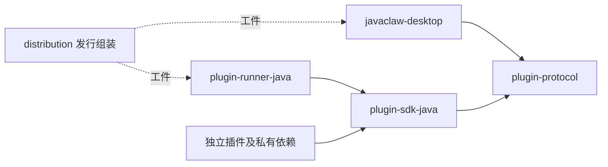
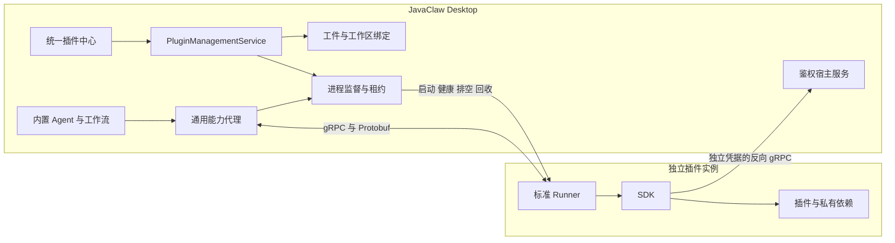

# 插件隔离 v2 与统一插件中心

外部插件在独立 JVM 中运行，Desktop 不加载插件 JAR、SDK 或 Runner 实现。内置 Agent 继续由宿主掌握状态机、权限、预算、审批与审计。本实现提供进程隔离，不提供操作系统沙箱；获准运行的插件仍拥有当前用户的操作系统权限。

## 模块与依赖



`plugin-protocol/src/main/proto/plugin_v2.proto` 是跨进程消息定义来源。SDK 提供生命周期、能力处理器和受限宿主回调，Runner 负责隔离类加载、RPC、取消和退出。Desktop 使用生成的协议类，业务调用不引用插件实现。插件的私有依赖只由子进程加载，允许与宿主使用不同依赖版本。

根 `pom.xml` 只聚合模块。宿主源码与测试分别位于 `javaclaw-desktop/src/main/` 和 `javaclaw-desktop/src/test/`，宿主 JAR、classes、测试报告与覆盖率报告均位于 `javaclaw-desktop/target/`。Runner、协议、SDK、示例插件与发行组装各用自身的 `target/`；根 `target/` 保留历史证据和便携镜像暂存。

## 运行架构



每个实例固定 `workspaceId + artifactHash + configurationRevision`，通过独立回环端口和双向独立凭据通信。宿主校验真实实例身份、工作区、调用租约、截止时间与当前授权；退出、重启、撤权使旧身份失效。回调使用独立执行容量。副作用调用不重试，断连后的未知结果返回 `UNKNOWN_OUTCOME`，需要核对结果后再决定下一步。

能力包括 TOOL、MODEL、SKILL、CONTEXT、WORKFLOW、HOOK。钩子按优先级、插件 ID 和贡献 ID 排序，只能收紧权限和预算。可选上下文失败记录并跳过，约束失败停止执行。外部工作流只接收公共图状态，不能读取或改写 `_` 开头的宿主内部根字段。外部插件不能返回 Spring Advisor、JavaFX、FXML、宿主对象或 Java Codec。

Run 和工作流持有精确工件与配置租约，恢复时缺失精确版本会拒绝恢复。模型主调用和辅助模型调用同样绑定 Run 的 MODEL 快照。普通升级只影响新 Run，撤权覆盖所有旧快照。插件创建的宿主调度持有执行租约、使用空工具权限，并在插件停止、撤权、卸载或工作区关闭时停用和取消。

SDK 根后台任务先申请宿主分配的租约，派生任务共享引用，最后一个任务结束时归还。租约有固定截止时间且不能续期；停止时立即拒绝新后台任务，已有任务仍可结算用量和完成获准的回调。宿主同时等待 Run、流和后台租约排空，撤权则立即取消。插件自行拼接的后台运行标识不能获得回调权限。

## 插件中心

原普通插件、Agent 扩展和模型服务入口统一为插件中心，按能力筛选。详情包含概览、配置、权限、运行与日志；模型插件的标准模型资源、配置及公开端点归属于选中的提供者。运行状态刷新不重建用户正在编辑的表单。

MODEL 贡献仅在实际提供监听接口时声明 `metadata.endpointCapabilities.openai` 字符串数组，也可放在 `metadata.inference.endpointCapabilities.openai`。允许值为 `models`（`/v1/models`）、`chat`（`/v1/chat/completions`）、`embeddings`（`/v1/embeddings`）、`sse`（聊天流）与 `openapi`（`/openapi.json`）。缺省为空；UI 同时检查模型能力，`chat` 要求 `chat` 能力，`embeddings` 要求 `embeddings` 能力，`sse` 要求已声明 `chat` 端点及 `chat`、`streaming` 能力。声明只说明实现支持，监听是否启用仍由配置与运行状态决定。Deliverance 声明其实际接口；echo-model 只验证 RPC 协议，不声明 HTTP 端点。

本地 ZIP 和 HTTPS 链接进入同一流程：下载/暂存 → 静态校验 → 预览 → 确认 → 原子登记。预览前不执行插件代码。下载支持取消、超时、大小限制和有限 HTTPS 重定向；解包拒绝越界、链接、重复路径与超限内容。签名无效拒绝安装，未验证来源要求明确确认。哈希相同的重复包不重复安装，同 ID 与版本但不同内容拒绝。

工件全局不可变保存，版本绑定、启用、配置与授权属于工作区。新安装默认停用且无授权。升级或选择历史版本只切当前工作区；候选配置不兼容或初始化失败保留原有效绑定。旧工件保留供租约与历史版本使用。

配置采用 JSON Schema 与受限 UI Schema。停用时仍可编辑静态配置；保存使用 `expectedRevision` 防止覆盖并发修改。秘密字段采用保留、替换、清除三种显式操作，读取仅显示是否已设置。可并存配置先启动候选再切换；声明独占资源时等待租约排空后应用，失败回退。权限减少立即取消相关调用。

普通停止阻止新调用并等待租约；强制结束需要额外确认。卸载预览显示所有工作区引用与活动任务，进入待卸载后排空并回收工件。默认保留配置和私有数据，删除数据须单独勾选，并在最后一个实例退出后清理，外部模型与文档不在清理范围内。能力消失后的配置引用保留并显示不可用，不自动替换。

## 包格式与开发

```text
plugin.zip
  plugin.json       身份、协议、能力、配置与通用运行要求
  plugin.jar        插件入口
  lib/*.jar         可选私有依赖
  files.sha256      完整文件清单
  signature.json    可选 Ed25519 签名与公钥
```

清单示例见 `sample-plugins/hello/plugin.json`；模型能力示例见 Deliverance 与 echo-model。`protocol.major=2`、能力 `contractVersion=2.0` 与插件自身 `version` 独立管理。JVM 模块接受合法的 `java.*` / `jdk.*` 系统模块名，逐项派生 `runtime.module:<name>` 权限；启动前检查实际模块存在。模块及 native access 均需明确批准，不对所有插件默认开放，禁止任意 JVM 参数和代理。

```bash
# 独立构建协议、SDK、Runner，并安装到本机 Maven 仓库
mvn -pl plugin-runner-java -am clean install

# 独立构建一个插件
mvn -f sample-plugins/hello/pom.xml clean verify

# 生成无签名的开发插件包；私有依赖可追加 --file lib/x.jar=/path/x.jar
java -cp plugin-runner-java/target/plugin-runner-java-4.0.0-SNAPSHOT-all.jar \
  com.javaclaw.plugin.sdk.packaging.PluginPackageMain \
  --manifest sample-plugins/hello/plugin.json \
  --artifact sample-plugins/hello/target/plugin.jar \
  --output /tmp/hello-2.0.0.zip
```

正式签包增加 `--private-key <PKCS8 PEM/DER> --public-key <X509 PEM/DER>`。私钥仅供构建时签包，不进入插件、发行包或仓库。插件中心会展示签名公钥指纹与来源，签名验证仅证明包内容与签名者一致。

## 数据与发行

默认使用 `data/` 和 `plugins/`，数据格式仍为 `5`。新默认根为空时重新初始化；旧版本的 `data-v5/`、`plugins-v2/` 和历史数据由用户手动处理，程序不自动迁移、覆盖或删除，旧重置标记不执行。非空 `data/` 的格式标记必须精确匹配。安装、升级和卸载使用统一锁、暂存区与恢复记录，未完成的事务在再次启动时恢复。

```bash
# 完整编译、测试、架构与覆盖率检查
mvn clean -Pui-test verify

# 只检查宿主和协议依赖；宿主测试使用 Desktop 模块的工作目录
mvn -pl javaclaw-desktop -am -Pui-test verify

# 发行产物位于 distribution/target/*-portable.zip
mvn -DskipTests package

# 扫描实际 Desktop 和 Runner JAR；后面可追加插件 ZIP 并检查私有 lib
python3 scripts/verify-plugin-isolation.py

# 可选：将已生成的插件包加入通用发行清单，随后重新打发行包
python3 scripts/stage-plugin-packages.py /tmp/hello-2.0.0.zip
mvn -pl distribution -am -DskipTests package
```

发行目录中 `runtime/desktop.jar` 与 `runtime/lib/*` 是唯一 Desktop classpath；`runtime/plugin-runner.jar` 只用于子进程。`plugin-distribution.json` 中的可选插件经同一包校验流程登记，默认停用，不覆盖已安装的用户版本。没有任何插件时主程序也可启动。

完成根目录的 `mvn -DskipTests install` 后，可从根运行 `mvn -pl javaclaw-desktop javafx:run`，也可从 `javaclaw-desktop/` 运行 `mvn javafx:run`。开发数据保存在聚合仓库根的 `data/` 与 `plugins/`。发行组装先将 `javaclaw-desktop/target/` 的 Maven 工件复制为 `distribution/target/runtime/desktop.jar`；装配脚本只读取这份组装结果。Python 校验与插件暂存脚本的默认发行目录从脚本位置确定，从模块目录调用也不改变默认目录；显式参数中的相对路径仍相对调用者的当前目录。

三平台原生打包在链接阶段使用 `ALL-MODULE-PATH` 保留发行 JDK 的完整模块，覆盖 JDBC、JShell、管理接口及反射、服务发现依赖；这不改变插件实例的权限和启动参数。显式 `--add-modules` 会替代 jpackage 的默认模块集合，参见 [JDK 25 jpackage 命令文档](https://docs.oracle.com/en/java/javase/25/docs/specs/man/jpackage.html)。macOS 和 Linux CI 还会使用包内 Java、独立 Runner 重跑 echo-model 集成测试。

`Plugin v2 isolation` CI 在三个操作系统上验证插件协议、进程生命周期与实际发行类路径，其中架构检查限定为 `externalPluginModulesOnlyDependOnVersionedProtocol`。完整质量门禁仍执行 `mvn clean -Pui-test verify` 及全部架构检查；原始 HEAD 已复现的三项架构失败仍是待解决的基线问题，专项 CI 不替代或放宽完整门禁。

独立进程、双向 RPC 与版本协商借鉴 [HashiCorp go-plugin](https://github.com/hashicorp/go-plugin)，能力分区参考 [Grafana backend 协议](https://github.com/grafana/grafana-plugin-sdk-go/blob/main/proto/backend.proto)，声明式贡献参考 [VS Code contribution points](https://code.visualstudio.com/api/references/contribution-points)。
